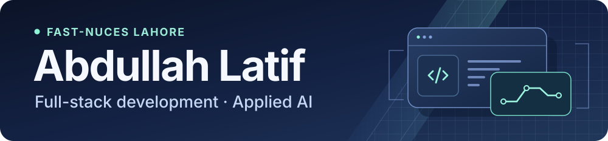

  

I'm a final-year Software Engineering student at **FAST-NUCES Lahore**. I build full-stack web apps with React, Next.js and Node.js. I also build AI features that extract structured data from documents and automate manual work.

**Open to graduate software engineering roles** in backend or full-stack development.

## Connect with Me

## Selected projects

### [Hireloop • AI Job Portal & ATS](https://github.com/Abdullah-Latif-10/AI-Job-Portal-ATS)

A hiring platform that lets candidates apply for jobs, recruiters review applications and schedule interviews, and admins manage the platform. It uses Gemini to extract skills from resumes and Socket.IO to notify candidates when their application or interview status changes.

`React` · `Node.js` · `Express` · `MongoDB` · `Gemini API` · `Socket.IO`

### [AI Invoice Extraction Pipeline](https://www.linkedin.com/feed/update/urn:li:activity:7480508639489945601/)

An n8n workflow that uses GPT-4o to extract invoice fields into Google Sheets. It flags duplicates and routes incomplete records for review.

`n8n` · `GPT-4o` · `Google Sheets`

## Languages & Tools

**Languages & web basics**  
   

**Web & data**  
     

**Applied AI & automation**  
 

**Cloud & CI**  
   

## What I'm exploring

- Designing APIs that support authentication and real-time features.
- Validating AI extracted data and routing uncertain results for review.
